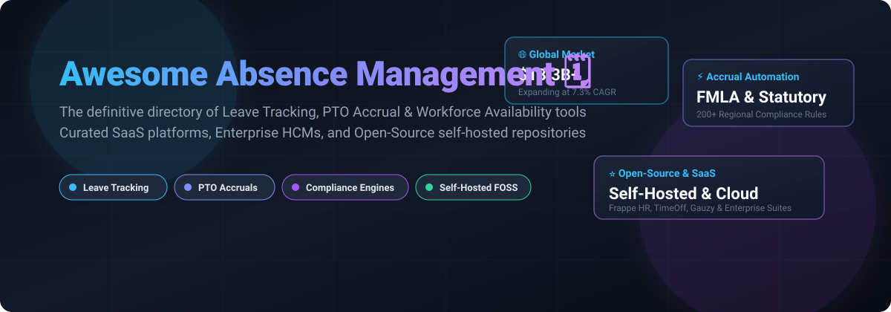

 
 

# 🌟 Awesome Absence Management 🗓️

**A Curated Directory of SaaS Platforms & Open-Source Projects for Absence Management, PTO Tracking, Leave Accrual & Workforce Planning** 🚀

---

## 📑 Table of Contents

- [🔍 Sector Overview & Market Dynamics](#-sector-overview--market-dynamics)
- [🏢 SaaS & Cloud Platforms](#-saas--cloud-platforms)
- [💻 Open-Source GitHub Projects](#-open-source-github-projects)
- [🧭 Decision & Implementation Matrix](#-decision--implementation-matrix)
- [🤝 How to Contribute](#-how-to-contribute)
- [💖 Support](#-support)
- [📈 Star History](#-star-history)
- [⚖️ Disclaimer & Compliance Notice](#️-disclaimer--compliance-notice)

---

## 🔍 Sector Overview & Market Dynamics

The global absence management and leave tracking software market is estimated at **$18.3 billion** and projected to reach **$25.9 billion by 2031** (growing at a **CAGR of ~7.3%**), propelled by shifting hybrid-work models, stricter regional labor regulations, and the need to curb unscheduled productivity leakage. The sector is **moderately fragmented**: Tier-1 enterprise HCM titans (ADP, Workday, UKG) command large-scale organizational contracts, while an aggressive tier of specialized SaaS providers (AbsenceSoft, BambooHR, Timetastic) and versatile open-source platforms compete actively on user experience, compliance engines, and self-hosted privacy.

---

## 🏢 SaaS & Cloud Platforms

The table below catalogs top SaaS and enterprise platforms for absence tracking and time-off administration, sorted in **descending order by company valuation/revenue**.

| 🏷️ Product | 🏢 Company Size (Revenue / Valuation) | 💵 Starting Pricing | 🎁 Free Tier Limits | 🎯 Best For & Key Features |
|:---|:---|:---|:---|:---|
| **[ADP Workforce Now](https://www.adp.com/)** | $21.9B+ Rev / ~$116B–$122B MCap | ~$23.00 PEPM (Core software-only starting tier) | No free tier or trial (Custom live sales demo only) | Established enterprises and mid-market teams needing deep payroll and attendance synchronization. |
| **[Workday Absence Management](https://www.workday.com/)** | $9.55B Rev / ~$50.6B MCap | ~$35.00/user/month (Absence module ~$6/FSE/yr in HCM package) | No free tier or trial (Sales-coordinated demo sandbox only) | Global enterprises requiring deep integration with enterprise financials, HCM, and compensation. |
| **[UKG Ready](https://www.ukg.com/)** | $4.7B Rev / ~$20B–$22B Valuation | ~$20.00 PEPM (Mid-market suite bundle base tier) | No free tier or trial (Scheduled guided product demos only) | Midsize to enterprise organizations seeking unified HR, timecard rules, and automated FMLA policies. |
| **[Paycom](https://www.paycom.com/)** | $2.05B Rev / ~$11B–$12B MCap | ~$25.00 PEPM (Core HCM bundle starting tier) | No free tier or trial (Custom sales quotes & walkthroughs only) | Organizations wanting mobile-first employee self-service time-off requests within a unified single database. |
| **[Factorial](https://factorial.com/)** | Scale: 16k+ businesses / $2.5B Valuation | ~$8.00/user/month (Operations & Time-off starting tier) | 14-day free trial (Full feature access, no credit card required; no permanent free tier) | Fast-scaling SMBs and startups needing leave tracking integrated with modern shift planning. |
| **[BambooHR](https://www.bamboohr.com/)** | ~$270M ARR / ~$1.5B Valuation | $10.00/user/month (Core tier; or $250/mo flat for teams ≤25) | 7-day free trial (Pre-populated sample data, no credit card required; no permanent free tier) | SMBs wanting intuitive leave request approvals, Who’s Out calendars, and automated PTO calculations. |
| **[Replicon](https://www.replicon.com/)** | ~$100M ARR (Acquired by Deltek) | $6.00/user/month (Time Off & Attendance base tier) | No standard free trial (Guided proof-of-concept demos upon request) | Global enterprises navigating multi-jurisdiction compliance (e.g., France, Brazil, Ireland labor rules). |
| **[AbsenceSoft](https://absencesoft.com/)** | ~$25M–$30M ARR (Backed by Luminate Capital) | ~$5,000/month (Enterprise compliance starting license) | No free tier or trial (Dedicated corporate walkthrough only) | High-compliance employers requiring dedicated tracking for 200+ federal/state leave mandates (FMLA/ADA). |
| **[Timetastic](https://timetasticapp.com/)** | ~$2.8M ARR (Bootstrapped) | $1.50/user/month (Standard plan; Pro at $2.50/user/mo) | 30-day free trial (Full access to all Pro features, no credit card required; no permanent free tier) | Small teams and agencies wanting lightweight, paperless leave approval calendars with Slack/Teams alerts. |
| **[LeaveBoard](https://leaveboard.com/)** | Bootstrapped Micro-SaaS | $1.35/user/month (Pro plan for teams of 10+ employees) | Free forever for up to 9 employees (Full HR dashboard, leave requests & approval workflows included) | Micro-businesses and distributed startups wanting zero-cost PTO management for teams under 10 members. |

---

## 💻 Open-Source GitHub Projects

Explore prominent self-hosted and community-driven absence management systems, sorted in **descending order by GitHub Stars_Count**.

| 📦 Repository & GitHub_Stars | 📜 License | 🛠️ Technology Stack | ⚡ Capabilities & Focus |
|:---|:---:|:---|:---|
| **[Frappe HR](https://github.com/frappe/hrms)**  | GPL-3.0 | Python (Frappe), Vue.js, MariaDB | Comprehensive leave allocation, automated accrual calculation, regional holiday calendar sync, and payroll tie-ins. |
| **[Ever Gauzy](https://github.com/ever-co/ever-gauzy)**  | AGPL-3.0 | TypeScript, NestJS, Angular, Docker | Business ERP & HRM suite with leave request approval workflows, employee timesheets, and contractor PTO tracking. |
| **[Attendify](https://github.com/AhmadHassan-BTed/Attendify)**  | MIT | PHP, MySQL, ag-Grid, JavaScript | Human-centric leave and attendance portal featuring rich interactive data grids, leave applications, and status logs. |
| **[Horilla](https://github.com/horilla/horilla-hr)**  | LGPL-3.0 | Python (Django), HTML5, PostgreSQL | Modern open-source HR platform featuring leave request pipelines, shift management, and self-service dashboards. |
| **[OrangeHRM](https://github.com/orangehrm/orangehrm)**  | GPL-2.0 | PHP, Symfony, MySQL | Established modular HRIS with customizable leave policies, carryover rules, approval hierarchies, and audit logging. |
| **[TimeOff.Management](https://github.com/timeoff-management/timeoff-management-application)**  | MIT | Node.js, Express, Sequelize, SQLite/PostgreSQL | Dedicated lightweight leave management application with department calendars, allowance tracking, and email alerts. |
| **[IceHrm](https://github.com/gamonoid/icehrm)**  | Apache-2.0 | PHP, AngularJS, MySQL | Employee self-service time-off applications, balance calculations, attendance tracking, and multi-currency support. |
| **[MintHCM](https://github.com/minthcm/minthcm)**  | GPL-3.0 | PHP (SugarCRM core), MySQL | Open-source HCM covering absence management, employee leave calendars, performance appraisals, and records. |
| **[Skapp](https://github.com/SkappHQ/skapp)**  | AGPL-3.0 | React, TypeScript, NestJS, Tailwind | Modern people management suite offering time-off requests, timesheets, and team directory views. |
| **[Sentrifugo](https://github.com/Sentrifugo/sentrifugo)**  | GPL-3.0 | PHP, MySQL, Apache | Flexible HR platform featuring multi-level leave approval hierarchies, holiday groups, and balance ledger tracking. |

---

## 🧭 Decision & Implementation Matrix

When evaluating absence management tooling for your organization, consider these key architectural dimensions:

- **Standalone PTO Tracker vs. Full HR Suite**: Specialized tools like **Timetastic**, **LeaveBoard**, and **TimeOff.Management** deliver instant time-to-value with frictionless onboarding. In contrast, enterprise suites (**Workday**, **ADP**, **Frappe HR**) unify leave records with payroll processing, tax withholdings, and contractual benefits.
- **Statutory & Legal Compliance**: If your company operates across jurisdictions with complex legal protections (e.g., US FMLA/ADA, California CFRA, European statutory holidays), enterprise engines like **AbsenceSoft** or configured **UKG** deployments prevent non-compliance penalties.
- **Data Sovereignty & Self-Hosting**: Organizations subject to stringent data governance or health privacy constraints can self-host **Frappe HR** or **TimeOff.Management** behind corporate firewalls to ensure zero third-party telemetry.

---

## 🤝 How to Contribute

Contributions to this list are welcome and encouraged! 🎉

1. 🍴 **Fork** this repository.
2. 🌿 **Create a new branch** (`git checkout -b feature/add-absence-tool`).
3. ✏️ **Add your entry** adhering to the tabular structure (include exact pricing, free trial specifications, tech stacks, or stargazer links).
4. 💾 **Commit changes** (`git commit -m 'feat: Add New-Tool to absence management list'`).
5. 📤 **Push to branch** (`git push origin feature/add-absence-tool`).
6. 🚀 **Open a Pull Request** with a concise description of why the tool is valuable.

---

## 💖 Support

If you find this curated absence management list useful:
- ⭐ **Star this repository** to help others discover it!
- 🍴 **Fork and share** it with fellow HR engineering teams and software leaders.
- ☕ **Sponsor or buy a coffee** via the [GitHub Sponsor Dashboard](https://github.com/sponsors/ishandutta2007) to support continuous updates and open-source curation!

---

## 📈 Star History

---

## ⚖️ Disclaimer & Compliance Notice

- This repository is community-curated for informational and architectural guidance purposes.
- Employee health and absence information represents highly sensitive personal data. Ensure all software deployments comply with applicable privacy laws including GDPR, CCPA, and HIPAA where medical leave tracking is involved.
- Third-party pricing estimates and features reflect market research and public benchmarks; always contact vendors directly for binding enterprise contracts.

---

  Maintained with ❤️ by <a href="https://github.com/ishandutta2007">Ishan Dutta</a> and the global open-source community.

